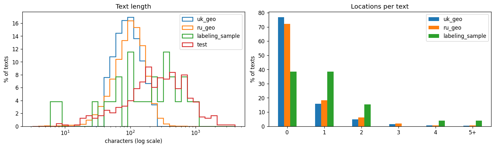
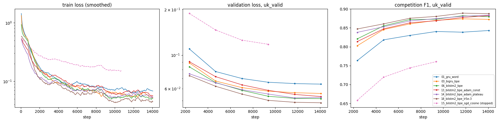
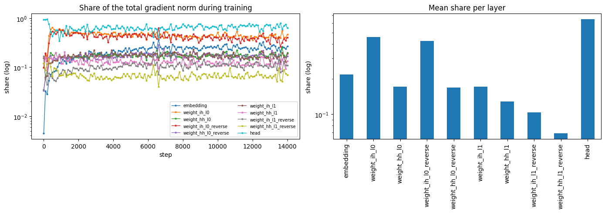
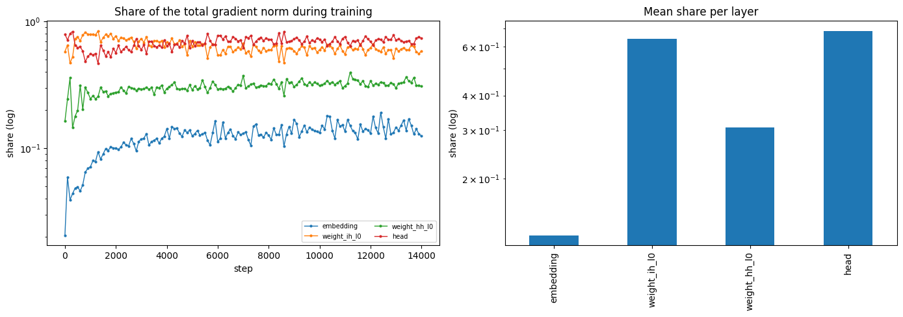
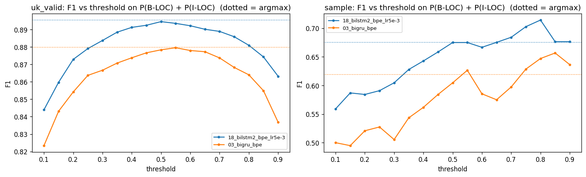

# Deep Learning HW 3
Author: Daniel Bond

## Task and Data
Task: Extract location strings from Ukrainian and Russian Telegram posts with recurrent models only. Evaluated with micro F1 over sets of location strings.

Notebooks:
- [DL-HW3-Part1.ipynb](./DL-HW3-Part1.ipynb) - EDA and metric analysis
- [DL-HW3-Part2.ipynb](./DL-HW3-Part2.ipynb) - validation strategy, span/tag conversion, tokenizers
- [DL-HW3-Part3.ipynb](./DL-HW3-Part3.ipynb) - adversarial validation, models, experiments (ran on Colab, T4 GPU)
- [DL-HW3-Part4.ipynb](./DL-HW3-Part4.ipynb) - thresholds, entity merging, ensembling, CV vs LB

Helpers (metric, tokenizers, dataset, decoding) are in [ner_utils.py](./ner_utils.py)

### Data analysis

| Dataset | Texts | Median chars | Multiline | With emoji | Has a location | Role |
|---|---|---|---|---|---|---|
| `uk_geo` | 1,010,000 | 91 | 0% | 0% | 23% | Ukrainian news sentences, LOC/ORG/PER labels, 10k marked `is_valid` |
| `ru_geo` | 8M (300k used) | 100 | 0% | 0% | 28% | Russian news sentences, grouped by `doc_id` |
| `labeling_sample` | 26 | 218 | 81% | 69% | 62% | human-made labels, same source as test |
| `test` | 477 | 264 | 85% | 60% | ? | Telegram posts, 90% Ukrainian, 7% Russian |

- Training data is news sentences, test is Telegram posts: longer, multiline, with emoji.
- 22% of the sample locations are streets, districts and landmarks vs 3.5% in news. 25% of the sample locations never appear as a location in 1.5M news sentences.
- A word vocabulary from 1M sentences leaves 6.8% of test words out of vocabulary - the motivation for BPE and fastText.

## Metric Analysis

In each text gold and predicted strings are normalized and compared as sets

Strengths:
- Measures the list of places in a text, regardless of position and number of mentions.
- Lenient to formatting and duplicates.
- Ignores true negatives.

Weaknesses:
- No partial credit: an extra or missing word is one FP and one FN.
- Different forms of one word are different strings.
- Micro pooling: long posts with lists of places dominate (one sample text holds 10 of 32 gold locations).

Edge cases:
- Predictions that normalize to an empty string are a guaranteed FP.
- Different apostrophes give different strings - predictions must be copied from the text.
- On 26 texts the bootstrap 95% interval of the metric is about +-0.15.

Complementary metrics: precision and recall; competition F1 by group (language, location type, text length).

Alternative: entity-level span F1 - a prediction is correct if its character span and type match a gold span exactly. It scores positions instead of strings, so word forms stop mattering, and it counts every mention.

## Validation

No single labelled set is enough, so three are used in layers:
1. Model selection - silver validation: the `uk_geo` `is_valid` split (10k sentences) and `ru_geo` split by document (`doc_id % 10 == 0`, 30k sentences), scored with the competition metric. Checkpoints are chosen by `uk_valid`.
2. In-domain check - all 26 `labeling_sample` texts, never trained on, with a bootstrap CI.
3. Public LB (~224 texts) - final comparison.

The splits are fixed rules, so every run is trained and validated on the same data.

Adversarial validation:

| Training texts vs test | AUC |
|---|---|
| news sentences | 0.990 |
| pseudo-posts | 0.970 |

The domains are separated almost perfectly either way, so only a weak correlation between silver validation and the LB was expected.

## Feature engineering

- Spans -> BIO tags over LOC, ORG, PER
- Tokenizers: word-level (100k words) and BPE (32k subwords)

| Tokenizer | Tokens per test post | `<unk>` in test | `<unk>` in sample locations |
|---|---|---|---|
| word | 73 | 11.0% | 27.7% |
| BPE | 95 | 1.4% | 0% |

- Pseudo-posts: 1-6 consecutive sentences glued with spaces or line breaks, to make training inputs look like test posts.
- Decoding: token tags -> character spans -> whole words -> unique strings cut from the original text. Predictions are stored per word as O / B-LOC / I-LOC, so models with different tokenizers can be averaged.

## Models

Embedding -> dropout -> GRU/LSTM -> dropout -> linear layer over BIO tags, cross-entropy loss. PyTorch Lightning, W&B logging.

Base configuration: BPE, 1-layer BiGRU, 128-d embeddings, 256 hidden, dropout 0.3, AdamW (weight decay 0.01), OneCycle with max lr 2e-3, gradient clipping at 1.0, 16-bit mixed precision, 3 epochs, batch 128 sentences (48 pseudo-posts). Training data: 500k `uk_geo` + 100k `ru_geo` sentences.

### Experiments

| Run | Setup | Params, M | CV: uk_valid | CV: ru_valid | CV: sample (95% CI) | Public LB |
|---|---|---|---|---|---|---|
| `01_gru_word` | word, GRU x1, unidirectional | 13.1 | 0.8449 | 0.8822 | 0.450 (0.26-0.63) | 0.4714 |
| `02_bigru_word` | word, BiGRU x1 | 13.4 | 0.8729 | 0.9122 | 0.488 (0.32-0.68) | 0.5127 |
| `03_bigru_bpe` | BPE, BiGRU x1 | 4.7 | 0.8798 | 0.9281 | 0.619 (0.47-0.74) | 0.5343 |
| `04_bigru2_bpe` | BPE, BiGRU x2 | 5.9 | 0.8847 | 0.9289 | 0.598 (0.44-0.73) | 0.5152 |
| `05_bilstm_bpe` | BPE, BiLSTM x1 | 4.9 | 0.8817 | 0.9327 | 0.634 (0.47-0.78) | 0.5341 |
| `06_bilstm2_bpe` | BPE, BiLSTM x2 | 6.5 | 0.8870 | 0.9357 | 0.633 (0.47-0.77) | 0.5593 |
| `07_bigru2_bpe_posts` | BPE, BiGRU x2, pseudo-posts | 5.9 | 0.8810 | 0.9271 | 0.579 (0.46-0.72) | 0.5508 |
| `08_bilstm2_bpe_posts` | BPE, BiLSTM x2, pseudo-posts | 6.5 | 0.8856 | 0.9334 | 0.590 (0.44-0.78) | 0.5629 |
| `09_bigru2_bpe_posts_loc` | BPE, BiGRU x2, pseudo-posts, LOC-only labels | 5.9 | 0.8763 | 0.9335 | 0.579 (0.44-0.76) | 0.5609 |
| `10_bilstm2_word` | word 300-d, BiLSTM x2 | 32.7 | 0.8788 | 0.9287 | 0.649 (0.52-0.78) | 0.5605 |
| `11_bilstm2_word_fasttext` | word, fastText init (fine-tuned), BiLSTM x2 | 32.7 | 0.8893 | 0.9421 | 0.521 (0.36-0.72) | 0.5581 |
| `12_bilstm2_word_fasttext_frozen` | word, fastText frozen, BiLSTM x2 | 32.7 | 0.8782 | 0.9198 | 0.618 (0.47-0.78) | 0.5671 |
| `13_bilstm2_bpe_adam_const` | BPE, BiLSTM x2, Adam, constant lr 1e-3 | 6.5 | 0.8890 | 0.9344 | 0.615 (0.44-0.76) | 0.5408 |
| `14_bilstm2_bpe_adam_plateau` | BPE, BiLSTM x2, Adam + ReduceLROnPlateau | 6.5 | 0.8888 | 0.9404 | 0.667 (0.49-0.81) | 0.5490 |
| `17_bilstm2_bpe_h384_d05` | BPE, BiLSTM x2, hidden 384, dropout 0.5 | 9.2 | 0.8752 | 0.9175 | 0.634 (0.48-0.76) | 0.5239 |
| `18_bilstm2_bpe_lr5e-3` | BPE, BiLSTM x2, lr 5e-3 | 6.5 | 0.8955 | 0.9409 | 0.675 (0.51-0.82) | 0.5759 |
| `19_bilstm2_bpe_posts_lr5e-3` | BPE, BiLSTM x2, pseudo-posts, lr 5e-3 | 6.5 | 0.8885 | 0.9401 | 0.632 (0.49-0.81) | 0.5589 |
| `18_bilstm2_bpe_lr5e-3_tuned` | run 18 + strict BIO + symbol stripping | - | 0.8966 | 0.9423 | 0.709 | 0.5862 |
| `ens_top2` | mean of 18 and 11, same decoding | - | 0.9065 | 0.9615 | 0.703 (0.55-0.88) | 0.5937 |
| `18_bilstm2_bpe_lr5e-3_thr08` | run 18, tuned decoding + threshold 0.8 (chosen on the sample) | - | 0.8832 | 0.9323 | 0.725 | **0.5969** |

What the experiments show:
- Bidirectional is the largest single gain (01 -> 02: +0.028 silver, +0.041 LB).
- BPE vs word-level: slightly better on silver, much better on the gold sample (0.62 vs 0.49) and the LB (+0.022) with a third of the parameters.
- LSTM x2 is the best encoder; the second layer adds ~0.005 on silver.
- Learning rate 5e-3 (18) is the best single model on every validation set and on the LB.
- fastText: fine-tuned is the best word-level model on silver but the worst on the sample; frozen is the opposite and scores better on the LB.
- LOC + ORG + PER labels beat LOC-only on silver (0.881 vs 0.876).

### Optimization curves

### Failed ideas

- SGD with momentum + cosine decay: 0.76 on `uk_valid` after two epochs, ~0.11 behind the Adam runs at the same step
- Pseudo-posts: lower on both validation sets, no stable effect on LB - some comparisons were better, some worse
- Combination of the winners (19: LSTM x2 + posts + lr 5e-3) is worse than run 18 on validation and the LB.
- Larger model with more dropout (17): worse everywhere
- Threshold chosen on silver validation: no threshold beats argmax there (tuning on gold sample did help)

## Thresholds, entity merging, ensembling

- Threshold on P(B-LOC) + P(I-LOC), chosen on silver validation: the best value on `uk_valid` (0.5) gives 0.8946 vs 0.8955 for argmax - no gain.
- Threshold chosen on the gold sample: there higher thresholds are better. For the best model 0.8 trades recall for precision and costs 0.014 on validation. The gain on 26 texts is within noise, so it was checked on the LB: 0.586 -> 0.597.
- The same threshold hurts the ensemble on the sample, so the ensemble keeps argmax.
- Entity merging for the best model:

| Variant | uk_valid | sample |
|---|---|---|
| lenient BIO | 0.8955 | 0.675 |
| strict BIO | 0.8966 | 0.684 |
| IO | 0.8856 | 0.675 |
| lenient + strip symbols | 0.8955 | 0.700 |
| strict + strip symbols | 0.8966 | 0.709 |

- Ensembling:

| Ensemble | Members | uk_valid | sample |
|---|---|---|---|
| `ens_top2` | 18, 11 | **0.9065** | 0.703 |
| `ens_top3` | 18, 11, 13 | 0.9050 | 0.720 |
| `ens_top5` | 18, 11, 13, 14, 19 | 0.9019 | 0.675 |
| `ens_diverse` | 18, 08, 12, 09 | 0.9032 | 0.623 |
| best single (18, tuned decoding) | | 0.8966 | 0.709 |

## Conclusions

- Final submissions: `18_bilstm2_bpe_lr5e-3_thr08` (LB 0.597) and `ens_top2` (LB 0.594).
- The model is adequate for an RNN: the best single model with argmax decoding (0.576) is above `ukr_rnn_baseline` (0.551), and both final submissions are just above `nlp_ua_bert_baseline` (0.593).
- It finds cities and regions reliably. Errors on gold posts are mostly about the definition of a location: generic mentions that annotators did not mark, streets cut to their name, items missed in long lists.
- The one change that used in-domain data - a threshold chosen on 26 gold posts - gave as much as ensembling.
- The main limit is the data: architecture changes moved the LB by 0.01-0.04, while the gap between validation and the LB is 0.3. In-domain labelled posts would help more than any further tuning.
